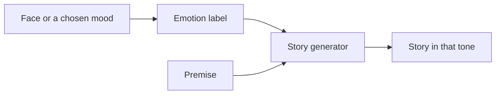
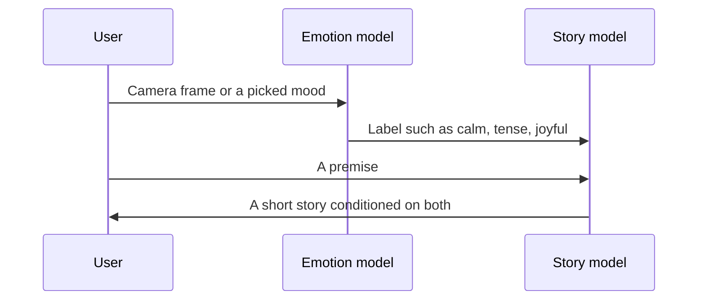

# Emotion-aware storyteller

A small interactive demo: read the listener's emotion, then generate a story whose tone matches it. Most story models ignore the person in front of the screen. This one does not.



## The loop



The interface is a Gradio-style app so the conditioning is visible. Change the expression, regenerate, and the tone should move with you. The emotion model is a classifier. The language model is not allowed to invent the label. That split is the whole design: perception decides the condition, generation writes inside it.

## Run it

```bash
python -m venv .venv && source .venv/bin/activate
pip install -r requirements.txt
```

Launch the app module in the repository root. A webcam is optional. The mood control is there so the demo still works without a camera, and so you can show that the story tracks the label rather than a frozen prompt.

## What this signals

A vision model and a language model with a clean contract between them. The label is an input, not a vibe buried in a prompt.
